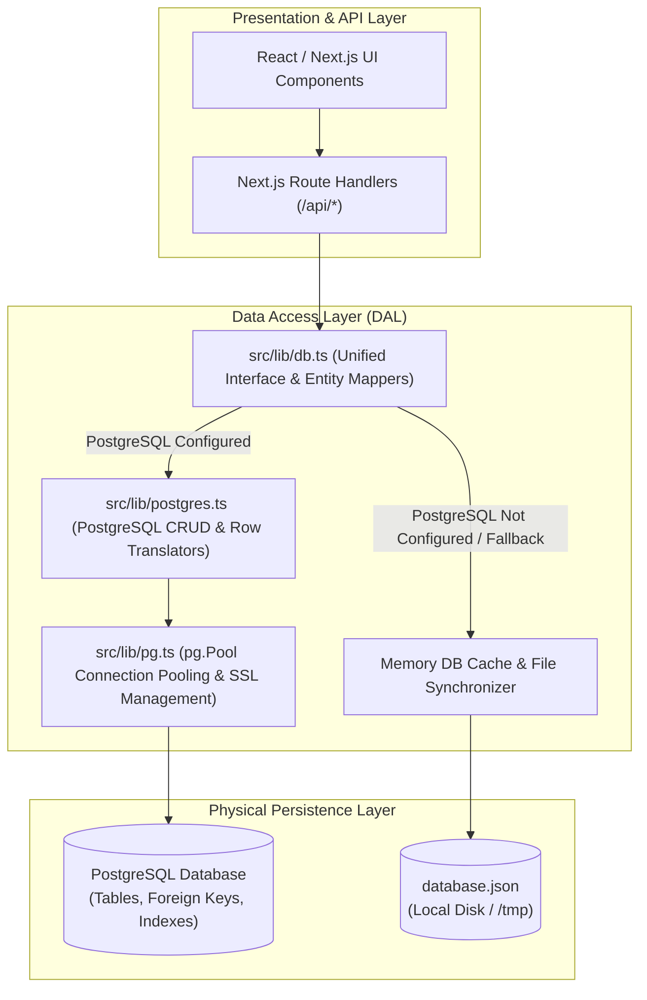
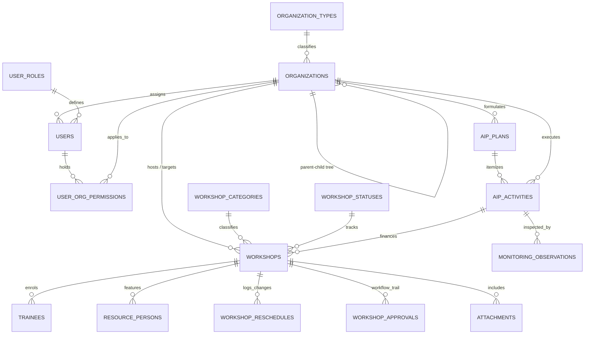

# Database Architecture Specification
**Workshop Management System (WMS) — Ministry of Education Sri Lanka**

---

## 1. Executive Architecture Summary

The Workshop Management System (WMS) employs a **hybrid dual-layer data storage architecture**:
1. **Primary Production Engine (PostgreSQL)**: Scalable, ACID-compliant relational database engine supporting serverless and cloud providers (e.g., Supabase, Neon, AWS RDS, self-hosted PostgreSQL).
2. **Fallback File-Based / In-Memory Store**: A structured JSON storage layer (`data/database.json` or `/tmp/database.json` in serverless/Vercel runtimes) with automatic in-memory caching and sync, ensuring full offline functionality and zero-downtime development when external database connectivity is unavailable.

---

## 2. Architectural Layers & Data Access Pattern

---

## 3. Entity-Relationship Model (Core Systems)

---

## 4. Database Schema Specifications

The canonical SQL definitions reside in `src/lib/schema.sql` and are maintained through `scripts/init-db.js`.

### 4.1. Module 1: Administrative Structure & RBAC

#### `organization_types`
Classifies administrative layers across national, provincial, and local levels.
| Column | Type | Constraints | Description |
| :--- | :--- | :--- | :--- |
| `id` | `VARCHAR(100)` | `PRIMARY KEY` | Unique identifier (e.g., `org-type-moe`) |
| `name` | `VARCHAR(255)` | `NOT NULL` | Descriptive name (Ministry, Province, Zone, School) |
| `level` | `INT` | `NOT NULL` | Hierarchy depth (1=MoE/NIE, 2=Province, 3=Zone, 4=School/Branch) |
| `description` | `TEXT` | | Purpose description |
| `created_at` | `TIMESTAMPTZ` | `DEFAULT NOW()` | Record creation timestamp |

#### `organizations`
Represents geographic entities and Ministry operational branches.
| Column | Type | Constraints | Description |
| :--- | :--- | :--- | :--- |
| `id` | `VARCHAR(100)` | `PRIMARY KEY` | Organization unique key (e.g., `org-wp`) |
| `name` | `VARCHAR(255)` | `NOT NULL` | Official organization title |
| `code` | `VARCHAR(100)` | | Administrative code |
| `type_id` | `VARCHAR(100)` | `REFERENCES organization_types(id)` | Associated administrative tier |
| `parent_id` | `VARCHAR(100)` | `REFERENCES organizations(id)` | Parent node for recursive tree structures |
| `unit_type` | `VARCHAR(50)` | `DEFAULT 'location'` | Classification: `'location'` or `'branch'` |
| `address` | `TEXT` | | Physical address |
| `phone` | `VARCHAR(50)` | | Contact telephone number |
| `email` | `VARCHAR(255)` | | Official email address |
| `is_active` | `BOOLEAN` | `DEFAULT TRUE` | Activation status |
| `created_at` | `TIMESTAMPTZ` | `DEFAULT NOW()` | Timestamp |

#### `user_roles`
Defines operational capabilities and authorization boundaries.
| Column | Type | Constraints | Description |
| :--- | :--- | :--- | :--- |
| `id` | `VARCHAR(100)` | `PRIMARY KEY` | Role ID (e.g., `superadmin`, `branch-officer`) |
| `name` | `VARCHAR(255)` | `NOT NULL` | Role label |
| `description` | `TEXT` | | Role mandate details |
| `can_create_workshop`| `BOOLEAN` | `DEFAULT FALSE` | Permission flag |
| `can_approve_workshop`| `BOOLEAN`| `DEFAULT FALSE` | Permission flag |
| `can_manage_users` | `BOOLEAN` | `DEFAULT FALSE` | User administrative permission |
| `can_view_reports` | `BOOLEAN` | `DEFAULT FALSE` | Reporting access |
| `can_manage_organizations`| `BOOLEAN`| `DEFAULT FALSE`| Organizational management flag |

#### `users`
Authenticated personnel accounts.
| Column | Type | Constraints | Description |
| :--- | :--- | :--- | :--- |
| `id` | `VARCHAR(100)` | `PRIMARY KEY` | User ID |
| `username` | `VARCHAR(100)` | `UNIQUE NOT NULL` | Login account handle |
| `password_hash`| `VARCHAR(255)` | `NOT NULL` | Bcrypt password hash |
| `full_name` | `VARCHAR(255)` | `NOT NULL` | Officer's full name |
| `email` | `VARCHAR(255)` | | Contact email |
| `phone` | `VARCHAR(50)` | | Contact number |
| `designation` | `VARCHAR(255)` | | Government official designation |
| `organization_id`| `VARCHAR(100)`| `REFERENCES organizations(id)` | Primary station/branch |
| `role_id` | `VARCHAR(100)` | `REFERENCES user_roles(id)` | Primary role |
| `is_active` | `BOOLEAN` | `DEFAULT TRUE` | Account validity flag |
| `last_login` | `TIMESTAMPTZ` | | Most recent session login |
| `created_at` | `TIMESTAMPTZ` | `DEFAULT NOW()` | Record creation timestamp |

#### `user_org_permissions`
Cross-organizational authorization mappings (matrix access).
| Column | Type | Constraints | Description |
| :--- | :--- | :--- | :--- |
| `id` | `VARCHAR(100)` | `PRIMARY KEY` | Mapping record ID |
| `user_id` | `VARCHAR(100)` | `REFERENCES users(id) ON DELETE CASCADE` | Assigned officer |
| `organization_id`| `VARCHAR(100)`| `REFERENCES organizations(id) ON DELETE CASCADE`| Target entity |
| `can_create` | `BOOLEAN` | `DEFAULT FALSE` | Authority to initiate workshops |
| `can_view` | `BOOLEAN` | `DEFAULT TRUE` | Authority to inspect records |
| `can_approve`| `BOOLEAN` | `DEFAULT FALSE` | Authority to endorse / approve |

---

### 4.2. Module 2: Workshop Operations

#### `workshops`
The core business entity capturing workshop planning, lifecycle states, and participant counts.
| Column | Type | Constraints | Description |
| :--- | :--- | :--- | :--- |
| `id` | `VARCHAR(100)` | `PRIMARY KEY` | Workshop UUID |
| `workshop_number`| `VARCHAR(100)`| | Sequential reference number |
| `year` | `VARCHAR(10)` | | Implementation year |
| `branch` | `VARCHAR(255)` | | Organizing department |
| `subject` | `VARCHAR(255)` | | Academic / operational subject |
| `title` | `VARCHAR(500)` | `NOT NULL` | Full title of the program |
| `aim` | `TEXT` | | Primary objective |
| `expected_output`| `TEXT` | | Tangible expected outcomes |
| `place_id` | `VARCHAR(100)` | | Location organization ID |
| `place_name` | `VARCHAR(255)` | | Location organization name |
| `target_level` | `VARCHAR(50)` | | Target tier (`national`, `province`, `zone`) |
| `target_path` | `JSONB` | `DEFAULT '[]'` | Organizational hierarchy path array |
| `days_held` | `INT` | `DEFAULT 1` | Program duration (days) |
| `workshop_type`| `VARCHAR(100)` | | Classification (e.g. In-service, Training) |
| `start_date` | `VARCHAR(50)` | | Scheduled start date |
| `end_date` | `VARCHAR(50)` | | Scheduled completion date |
| `venue` | `VARCHAR(500)` | | Venue hall / institution |
| `organizing_org_id`| `VARCHAR(100)`| | Sponsoring / organizing organization |
| `target_org_id`| `VARCHAR(100)` | | Target beneficiary organization |
| `is_self_organized`| `BOOLEAN` | `DEFAULT FALSE` | Internal workshop flag |
| `expected_trainees`| `INT` | `DEFAULT 0` | Forecasted attendance |
| `actual_trainees`| `INT` | `DEFAULT 0` | Verified physical attendance |
| `status` | `VARCHAR(50)` | `DEFAULT 'Scheduled'` | Status (`Scheduled`, `In Progress`, `Completed`, `Rescheduled`, `Cancelled`) |
| `confirmation_status`| `VARCHAR(50)`| `DEFAULT 'Confirmed'`| Confirmation indicator |
| `reschedule_count`| `INT` | `DEFAULT 0` | Number of rescheduling occurrences |
| `created_by` | `VARCHAR(100)` | | Officer creator ID |
| `created_at` | `TIMESTAMPTZ` | `DEFAULT NOW()` | Created timestamp |
| `updated_at` | `TIMESTAMPTZ` | `DEFAULT NOW()` | Last update timestamp |

#### `workshop_reschedules`
Immutable audit log of all schedule, venue, and duration changes.
| Column | Type | Constraints | Description |
| :--- | :--- | :--- | :--- |
| `id` | `VARCHAR(100)` | `PRIMARY KEY` | Event ID |
| `workshop_id` | `VARCHAR(100)` | `REFERENCES workshops(id) ON DELETE CASCADE` | Linked workshop |
| `rescheduled_by_user_id`| `VARCHAR(100)`| | Action officer user ID |
| `rescheduled_by_name`| `VARCHAR(255)`| | Action officer name |
| `rescheduled_by_org_name`| `VARCHAR(255)`| | Action officer branch/organization |
| `old_start_date` | `VARCHAR(50)` | | Prior start date |
| `old_end_date` | `VARCHAR(50)` | | Prior end date |
| `old_days_held` | `INT` | | Prior duration |
| `old_venue` | `VARCHAR(500)` | | Prior venue |
| `new_start_date` | `VARCHAR(50)` | | Adjusted start date |
| `new_end_date` | `VARCHAR(50)` | | Adjusted end date |
| `new_days_held` | `INT` | | Adjusted duration |
| `new_venue` | `VARCHAR(500)` | | Adjusted venue |
| `reason` | `TEXT` | | Justification for rescheduling |
| `created_at` | `TIMESTAMPTZ` | `DEFAULT NOW()` | Log timestamp |

#### `trainees`
Individual participant tracking, registration, and daily attendance records.
| Column | Type | Constraints | Description |
| :--- | :--- | :--- | :--- |
| `id` | `VARCHAR(100)` | `PRIMARY KEY` | Trainee record ID |
| `workshop_id` | `VARCHAR(100)` | `REFERENCES workshops(id) ON DELETE CASCADE` | Linked workshop |
| `serial_number` | `INT` | | List sequence number |
| `nic_number` | `VARCHAR(50)` | | National Identity Card number |
| `name` | `VARCHAR(255)` | `NOT NULL` | Participant full name |
| `position` | `VARCHAR(255)` | | Academic / Administrative title |
| `school_institute`| `VARCHAR(255)`| | Originating school or center |
| `region` | `VARCHAR(255)` | | Educational zone / region |
| `province` | `VARCHAR(255)` | | Province |
| `attendance_status`| `VARCHAR(50)` | `DEFAULT 'registered'` | Status (`registered`, `attended`, `absent`) |
| `daily_attendance`| `JSONB` | `DEFAULT '{}'` | Day-to-day attendance tracking dictionary |

#### `resource_persons`
Subject matter experts, guest lecturers, and trainers.
| Column | Type | Constraints | Description |
| :--- | :--- | :--- | :--- |
| `id` | `VARCHAR(100)` | `PRIMARY KEY` | Record ID |
| `workshop_id` | `VARCHAR(100)` | | Associated workshop (or global pool) |
| `nic` | `VARCHAR(50)` | | National Identity Card |
| `name` | `VARCHAR(255)` | `NOT NULL` | Resource person name |
| `workplace` | `VARCHAR(255)` | | Primary institution / university |
| `educational_qualifications` | `TEXT` | | Academic degrees |
| `subject_qualifications` | `TEXT` | | Domain expertise certifications |
| `phone` | `VARCHAR(50)` | | Telephone number |
| `email` | `VARCHAR(255)` | | Email address |
| `role_in_workshop` | `VARCHAR(255)` | | Facilitator, Speaker, or Coordinator |

---

### 4.3. Module 3: Annual Implementation Plan (AIP) & Activities

#### `aip_plans`
Annual master plans formulated by departments and divisions.
| Column | Type | Constraints | Description |
| :--- | :--- | :--- | :--- |
| `id` | `VARCHAR(100)` | `PRIMARY KEY` | Plan ID |
| `branch_id` | `VARCHAR(100)` | `REFERENCES organizations(id) ON DELETE CASCADE` | Formulating branch |
| `branch_name` | `VARCHAR(255)` | | Branch display title |
| `year` | `VARCHAR(10)` | `NOT NULL DEFAULT '2027'` | Target financial year |
| `phase_title` | `VARCHAR(255)` | | Planning phase descriptor |
| `main_responsibility` | `VARCHAR(255)` | | Primary designated officer |
| `status` | `VARCHAR(50)` | `DEFAULT 'Draft'` | Plan state (`Draft`, `Submitted`, `Approved`) |
| `created_at` | `TIMESTAMPTZ` | `DEFAULT NOW()` | Submission timestamp |

#### `aip_activities`
Detailed line-item activities linked to financial votes and quarterly milestones.
| Column | Type | Constraints | Description |
| :--- | :--- | :--- | :--- |
| `id` | `VARCHAR(100)` | `PRIMARY KEY` | Activity ID |
| `plan_id` | `VARCHAR(100)` | `REFERENCES aip_plans(id) ON DELETE SET NULL` | Parent master plan |
| `branch_id` | `VARCHAR(100)` | `REFERENCES organizations(id) ON DELETE CASCADE` | Responsible branch |
| `year` | `VARCHAR(10)` | `NOT NULL` | Financial year |
| `activity_code`| `VARCHAR(50)` | `NOT NULL` | Program code (e.g. `ACT-01`) |
| `activity` | `TEXT` | `NOT NULL` | Activity narrative description |
| `vote_number` | `VARCHAR(100)` | | Treasury budget vote number |
| `estimated_cost`| `NUMERIC(15,3)`| `DEFAULT 0` | Budgeted cost allocation |
| `financial_months`| `JSONB` | `DEFAULT '[]'` | 12-month financial distribution array |
| `physical_months` | `JSONB` | `DEFAULT '[]'` | 12-month physical milestones array |
| `financial_q1`-`q4`| `NUMERIC(15,3)`| `DEFAULT 0` | Quarterly financial aggregates |
| `target_q1`-`q4` | `VARCHAR(50)` | | Quarterly target descriptions |
| `responsible_officer`| `VARCHAR(255)`| | Officer-in-charge |
| `created_by` | `VARCHAR(100)` | `REFERENCES users(id) ON DELETE SET NULL` | Author ID |

---

### 4.4. Module 4: Financial Governance & Quality Assurance (FRS)

- **`strategic_objectives` $\rightarrow$ `programmes` $\rightarrow$ `projects`**: Hierarchical 3-level national education strategy alignment.
- **`budget_ceilings` & `budget_allocations` & `budget_revisions`**: Manages treasury ceiling limits, division allocations, commitments, actual payments, and revision requests.
- **`budget_proposal_activities`**: Two-stage budget proposals with review feedback, justification, and Budget Speech flagging.
- **`monitoring_observations` & `corrective_actions`**: Field audit records, deviation severity classifications (`Low`, `Medium`, `High`, `Critical`), and corrective workflows.
- **`verification_records` & `evidence_files`**: Physical vs. financial verification logs and proof attachments.
- **`system_audit_logs`**: Immutable security and transaction logs across Governance, Financial, Operational, and Security categories.

---

## 5. Performance Indexing Matrix

| Index Name | Table | Indexed Columns | Index Purpose |
| :--- | :--- | :--- | :--- |
| `idx_organizations_parent` | `organizations` | `(parent_id)` | Speeds up recursive organizational tree traversal |
| `idx_organizations_type` | `organizations` | `(type_id)` | Fast filtering by administrative tier |
| `idx_users_org` | `users` | `(organization_id)` | Accelerates user-by-branch lookups |
| `idx_users_role` | `users` | `(role_id)` | Speeds up RBAC authorization checks |
| `idx_workshops_place` | `workshops` | `(place_id)` | Speeds up location-specific workshop filtering |
| `idx_workshops_target_org` | `workshops` | `(target_org_id)` | Facilitates target audience queries |
| `idx_workshops_status` | `workshops` | `(status)` | Optimizes dashboard filtering by workflow stage |
| `idx_workshops_year` | `workshops` | `(year)` | Optimizes annual reporting and archiving |
| `idx_trainees_workshop` | `trainees` | `(workshop_id)` | Optimizes attendance sheet retrieval |
| `idx_resource_persons_workshop`| `resource_persons` | `(workshop_id)` | Fast lookup of faculty for workshops |
| `idx_aip_plans_branch` | `aip_plans` | `(branch_id, year)` | Fast retrieval of annual branch plans |
| `idx_aip_activities_branch` | `aip_activities` | `(branch_id, year)` | Fast retrieval of branch annual line-item activities |
