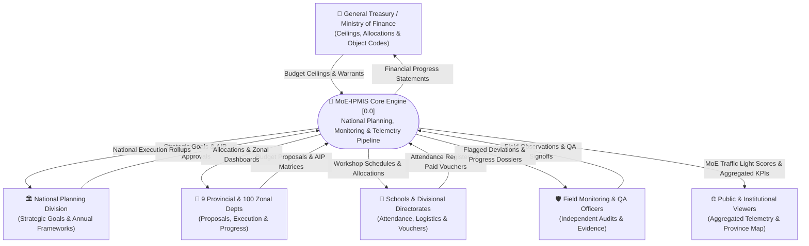
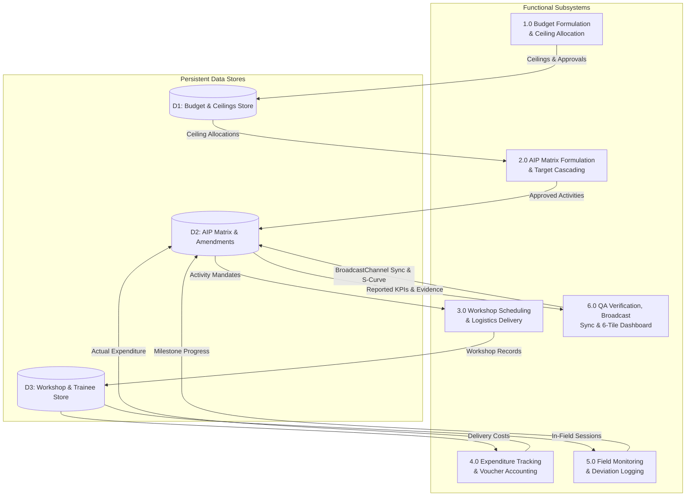
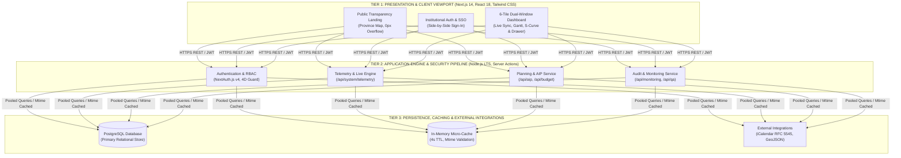

# MoE-IPMIS: Data Flow Diagrams (DFDs) & System Architecture Specification

**System Name:** Ministry of Education Integrated Planning & Monitoring Information System (MoE-IPMIS)  
**Document Identifier:** MOE-IPMIS-DFD-2026-V2.5  
**Release Version:** Version 2.5.0 (Dual-Window 6-Tile Management Dashboard & Live Sync Baseline)  
**Effective Date:** 14 November 2026  
**Issuing Authority:** Data Management & Information Systems Development Unit (DMISDU)  

---

## 1. DFD Level 0: National System Context Diagram

The DFD Level 0 Context Diagram establishes the boundary of the MoE-IPMIS core system and models the data interchanges between external government entities, ministerial divisions, provincial authorities, field officers, and transparency consumers.

### 1.1 Process Model Specification
- **Process [0.0]**: MoE-IPMIS Core System (National Data Engine & Telemetry Pipeline).
- **External Entity 1: General Treasury / Ministry of Finance**: Emits capital & recurrent budget ceilings and object codes; receives aggregated quarterly financial execution summaries and warrant utilization statements.
- **External Entity 2: National Planning Division**: Dispatches MTEF 3-year strategic guidelines and approved annual activity frameworks; receives consolidated national rollups and amendment dossiers.
- **External Entity 3: 9 Provincial & 100 Zonal Departments of Education**: Formulates decentralized 29-column AIP activity proposals and operational cost schedules; consumes approved allocations, expenditure ceilings, and zonal management dashboards.
- **External Entity 4: Schools & Divisional Directorates**: Emits training delivery records, participant attendance verification, and localized expenditure vouchers; receives scheduled workshop mandates and resource person allocations.
- **External Entity 5: Field Monitoring & QA Verification Officers**: Records independent on-site audit observations, deficiency logs, and photographic evidence; consumes self-reported progress claims for verification signoff.
- **External Entity 6: Public & Institutional Transparency Consumers**: Consumes read-only aggregated telemetry, MoE 6-tier traffic light provincial heatmaps, and national S-curve trajectory indices.

### 1.2 Visual Diagram

*(High-resolution visual render available at `docs/diagrams/dfd_level_0_context.png`)*

---

## 2. DFD Level 1: Subsystem Data Flow Architecture

The DFD Level 1 diagram decomposes the IPMIS core system into six functional subsystems, five persistent data stores, and the multi-tier live synchronization engine.

### 2.1 Subsystem Decomposition
1. **[1.0] Budget Formulation & Ceiling Allocation**: Validates ministerial and provincial budget submissions against Treasury ceilings and national MTEF horizons.
2. **[2.0] AIP Matrix Formulation & Target Cascading**: Manages 25-column national and 29-column provincial Annual Implementation Plans, quarterly milestone breakdowns, and formal amendment cycles.
3. **[3.0] Workshop Scheduling & Logistics Delivery**: Coordinates ground training execution, participant rosters, venue clash detection, and RFC 5545 calendar subscriptions.
4. **[4.0] Expenditure Tracking & Voucher Accounting**: Manages 3-tier commitment and payment voucher records, calculating budget absorption and cost variances.
5. **[5.0] Field Monitoring & Deviation Logging**: Logs on-site inspection observations, severity levels (Critical, High, Medium, Low), and corrective action remediation workflows.
6. **[6.0] QA Verification, Live Sync & 6-Tile Dashboard**: Evaluates self-reported progress against verified evidence dossiers, calculates composite performance scores, dispatches real-time broadcast sync events, and renders the dual-window management dashboard.

### 2.2 Data Store Definitions
- **D1: Budget & Ceilings Store**: Recurrent and capital allocations, expenditure limits, warrant ledger.
- **D2: AIP Matrix & Amendments Store**: Multi-year activity definitions, quarter-by-quarter baseline targets, and verified progress records.
- **D3: Workshop & Trainee Store**: Workshop schedule records, teacher enrollment rosters, attendance registries, and venue bookings.
- **D4: Field Monitoring & Observations Store**: On-site audit findings, root-cause classifications, and remedial directives.
- **D5: Audit & Security Store**: Immutable transaction audit log entries with user identification, client IP, timestamp, and entity diff snapshots.

### 2.3 Visual Diagram

*(High-resolution visual render available at `docs/diagrams/dfd_level_1_overview.png`)*

---

## 3. DFD Level 2: Detailed AIP Activity & Workshop Execution Lifecycle

Models the sequential step-by-step lifecycle from 3-year strategic objective formulation to grassroots workshop delivery, independent QA verification, and real-time dashboard telemetry rollup.

### 3.1 Process Steps
- **2.1**: Strategic Objective & Programme Mapping (MTEF 3-Year Horizon).
- **2.2**: 25/29-Column AIP Formulation & Quarterly Target Allocation.
- **2.3**: National / Apex Administrative Approval & Statutory Warrants.
- **2.4**: Workshop Scheduling & Trainee/Resource Person Registry.
- **2.5**: Ground Workshop Execution & Digital Attendance Vouchers.
- **2.6**: Expenditure Posting & Self-Reported Physical Milestone Recording.
- **2.7**: Field M&E Inspection & Root-Cause Deviation Logging.
- **2.8**: Independent QA Evidence Verification & Dossier Signoff.
- **2.9**: Live Telemetry Rollup & 6-Tile Multi-Window Dashboard Sync.

### 3.2 Visual Diagram

```mermaid
flowchart LR
    Step1["2.1 Strategic Objective<br/>& Programme Mapping"] -->|"Strategic Link"| Step2["2.2 25/29-Col AIP<br/>Quarterly Targets"]
    Step2 -->|"Submit Plan"| Step3["2.3 National / Apex<br/>Administrative Approval"]
    Step3 -->|"Approved Mandate"| Step4["2.4 Workshop Scheduling<br/>& Trainee Registry"]
    Step4 -->|"Sessions Ready"| Step5["2.5 Workshop Execution<br/>& Attendance Vouchers"]
    Step5 -->|"Attendance Held"| Step6["2.6 Expenditure Posting<br/>& Milestone Progress"]
    Step6 -->|"Reported Claims"| Step7["2.7 Field M&E Inspection<br/>& Deviation Logging"]
    Step7 -->|"Audit Findings"| Step8["2.8 Independent QA<br/>Evidence Verification"]
    Step8 -->|"QA Verified Signoff"| Step9["2.9 Live Telemetry Rollup<br/>& 6-Tile Management Sync"]
```

*(High-resolution visual render available at `docs/diagrams/dfd_level_2_aip_workshop.png`)*

---

## 4. Full System Architecture & Technology Stack

The IPMIS system is engineered as a cloud-native, high-performance web platform structured across three architectural tiers.

### 4.1 Architecture Overview
- **Tier 1: Presentation & Client Viewport**: Next.js 14 App Router, React 18, Tailwind CSS, GPU hardware-accelerated SVG graphs, and client-side `BroadcastChannel` real-time sync.
- **Tier 2: Application Engine & Security Pipeline**: Next.js Route Handlers and Server Actions, NextAuth.js v4 4D-RBAC security guard, telemetry micro-caching aggregation engine, and SLST timestamp validator.
- **Tier 3: Persistence & Caching Tier**: Primary PostgreSQL relational store, in-memory micro-cache (4s TTL) with stat mtime validation, local filesystem snapshot fallback, and external RFC 5545 calendar and GIS geoBoundaries integrations.

### 4.2 Visual Diagram

*(High-resolution visual render available at `docs/diagrams/system_architecture_diagram.png`)*
